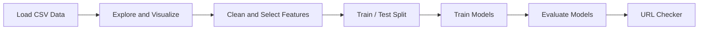

# Phishing Website Detection

A machine learning project that detects phishing websites from URL and web page features using Python and scikit-learn.

[](https://colab.research.google.com/github/ahsanmurtaza875/Phishing-Website-Detection/blob/main/phishing_website_detection.ipynb)


## Overview

Phishing is a method of trying to gather personal information using deceptive e-mails and websites. This project trains classification models to tell whether a website is **phishing** or **legitimate**, based on features extracted from its URL and page content. The notebook also includes a simple URL checker.

## Project Workflow



## Dataset

- **File:** `Phishing_Legitimate_full.csv`
- **Source:** Kaggle (add the link to the dataset page here)
- **Content:** 10,000 websites (5,000 phishing, 5,000 legitimate) with 48 extracted features
- **Target column:** `CLASS_LABEL` (1 = phishing, 0 = legitimate)

### Class Distribution

The dataset is balanced, so accuracy is a fair metric.


## Exploratory Analysis

### Features Most Related to the Target

These features have the strongest correlation with whether a site is phishing.


### Correlation Heatmap


## Models and Results

Models trained: Random Forest, Decision Tree, and Logistic Regression.


| Model | Accuracy |
|-------|----------|
| Random Forest | XX% |
| Decision Tree | XX% |
| Logistic Regression | XX% |

### Confusion Matrix (Best Model)


### Most Important Features


## How to Run

### Option 1: Google Colab (easiest)

1. Click the **Open in Colab** badge at the top of this page.
2. Click **Runtime → Run all**.

The notebook loads the dataset directly from this repository, so no manual upload is needed.

### Option 2: On your computer

```bash
git clone https://github.com/ahsanmurtaza875/Phishing-Website-Detection.git
cd Phishing-Website-Detection
pip install -r requirements.txt
jupyter notebook phishing_website_detection.ipynb
```

If running locally, change the data loading line in the notebook to:

```python
data = pd.read_csv("Phishing_Legitimate_full.csv")
```

## Repository Structure

```
Phishing-Website-Detection/
├── images/                            # Charts used in this README
├── phishing_website_detection.ipynb   # Main notebook
├── Phishing_Legitimate_full.csv       # Dataset
├── requirements.txt                   # Python libraries
├── README.md                          # Project description
├── LICENSE                            # MIT License
└── .gitignore
```

## Tech Stack

Python, pandas, NumPy, Matplotlib, Seaborn, scikit-learn

## Author

**Ahsan Murtaza**
GitHub: [@ahsanmurtaza875](https://github.com/ahsanmurtaza875)
