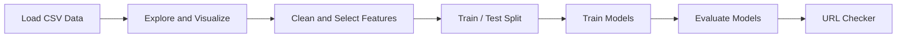

# Phishing Website Detection

A machine learning project that detects phishing websites from URL and web page features using Python and scikit-learn.

[](https://colab.research.google.com/github/ahsanmurtaza875/Phishing-Website-Detection/blob/main/phishing_website_detection.ipynb)


## Overview

Phishing is a method of trying to gather personal information using deceptive e-mails and websites. This project trains classification models to tell whether a website is **phishing** or **legitimate**, based on features extracted from its URL and page content. The notebook also includes a simple URL checker.

## Project Workflow



## Dataset

- **File:** `Phishing_Legitimate_full.csv`
- **Source:** Kaggle (add the link to the dataset page here)
- **Content:** 10,000 websites (5,000 phishing, 5,000 legitimate) with 48 extracted features
- **Target column:** `CLASS_LABEL` (1 = phishing, 0 = legitimate)

### Class Distribution

The dataset is balanced, so accuracy is a fair metric.


## Exploratory Analysis

### Features Most Related to the Target

These features have the strongest correlation with whether a site is phishing.


### Correlation Heatmap


## Models and Results

Models trained: Random Forest, Decision Tree, and Logistic Regression.


| Model | Accuracy |
|-------|----------|
| Random Forest | XX% |
| Decision Tree | XX% |
| Logistic Regression | XX% |

### Confusion Matrix (Best Model)


### Most Important Features


## How to Run

### Option 1: Google Colab (easiest)

1. Click the **Open in Colab** badge at the top of this page.
2. Click **Runtime → Run all**.

The notebook loads the dataset directly from this repository, so no manual upload is needed.

### Option 2: On your computer

```bash
git clone https://github.com/ahsanmurtaza875/Phishing-Website-Detection.git
cd Phishing-Website-Detection
pip install -r requirements.txt
jupyter notebook phishing_website_detection.ipynb
```

If running locally, change the data loading line in the notebook to:

```python
data = pd.read_csv("Phishing_Legitimate_full.csv")

# Paste this into a NEW cell at the END of your Colab notebook and run it.
# It uses your existing `data` DataFrame, trains 3 models, saves all charts
# into an "images" folder, and downloads them as images.zip.

import os
import numpy as np
import pandas as pd
import matplotlib.pyplot as plt
import seaborn as sns
from sklearn.model_selection import train_test_split
from sklearn.ensemble import RandomForestClassifier
from sklearn.tree import DecisionTreeClassifier
from sklearn.linear_model import LogisticRegression
from sklearn.preprocessing import StandardScaler
from sklearn.pipeline import make_pipeline
from sklearn.metrics import accuracy_score, confusion_matrix, ConfusionMatrixDisplay

os.makedirs("images", exist_ok=True)
target = "CLASS_LABEL"          # change if your target column has another name

df = data.drop(columns=[c for c in ["id", "Id", "ID"] if c in data.columns])
X = df.drop(columns=[target])
y = df[target]

def save(name):
    plt.tight_layout()
    plt.savefig(f"images/{name}.png", dpi=150, bbox_inches="tight")
    plt.show()

# 1. Class distribution
plt.figure(figsize=(6, 4))
ax = sns.countplot(x=y, palette=["#2ecc71", "#e74c3c"])
ax.set_xticklabels(["Legitimate (0)", "Phishing (1)"])
ax.set_title("Class Distribution")
ax.set_xlabel("")
for p in ax.patches:
    ax.annotate(int(p.get_height()), (p.get_x() + p.get_width() / 2, p.get_height()),
                ha="center", va="bottom")
save("class_distribution")

# 2. Top correlated features
corr = X.corrwith(y).sort_values(key=abs, ascending=False).head(15)
plt.figure(figsize=(8, 6))
sns.barplot(x=corr.values, y=corr.index, palette="coolwarm")
plt.title("Top 15 Features Correlated with Phishing")
plt.xlabel("Correlation with CLASS_LABEL")
save("top_correlations")

# 3. Correlation heatmap of top 10 features
top10 = corr.index[:10].tolist() + [target]
plt.figure(figsize=(9, 7))
sns.heatmap(df[top10].corr(), annot=True, fmt=".2f", cmap="coolwarm", square=True)
plt.title("Correlation Heatmap (Top 10 Features)")
save("correlation_heatmap")

# 4. Train and compare models
X_train, X_test, y_train, y_test = train_test_split(
    X, y, test_size=0.2, random_state=42, stratify=y)

models = {
    "Random Forest": RandomForestClassifier(n_estimators=200, random_state=42),
    "Decision Tree": DecisionTreeClassifier(random_state=42),
    "Logistic Regression": make_pipeline(StandardScaler(), LogisticRegression(max_iter=2000)),
}

results = {}
for name, model in models.items():
    model.fit(X_train, y_train)
    results[name] = accuracy_score(y_test, model.predict(X_test)) * 100

plt.figure(figsize=(7, 4.5))
ax = sns.barplot(x=list(results.keys()), y=list(results.values()), palette="viridis")
ax.set_ylim(min(results.values()) - 5, 100)
ax.set_ylabel("Accuracy (%)")
ax.set_title("Model Comparison")
for p in ax.patches:
    ax.annotate(f"{p.get_height():.2f}%", (p.get_x() + p.get_width() / 2, p.get_height()),
                ha="center", va="bottom")
save("model_comparison")

# 5. Confusion matrix of the best model
best_name = max(results, key=results.get)
best_model = models[best_name]
cm = confusion_matrix(y_test, best_model.predict(X_test))
ConfusionMatrixDisplay(cm, display_labels=["Legitimate", "Phishing"]).plot(cmap="Blues")
plt.title(f"Confusion Matrix - {best_name}")
save("confusion_matrix")

# 6. Feature importance (Random Forest)
imp = pd.Series(models["Random Forest"].feature_importances_, index=X.columns)
imp = imp.sort_values(ascending=False).head(15)
plt.figure(figsize=(8, 6))
sns.barplot(x=imp.values, y=imp.index, palette="magma")
plt.title("Top 15 Feature Importances (Random Forest)")
plt.xlabel("Importance")
save("feature_importance")

# Print the numbers for your README results table
print("\nACCURACY RESULTS (copy into README):")
for name, acc in results.items():
    print(f"{name}: {acc:.2f}%")

# Zip and download all images
!zip -r images.zip images
from google.colab import files
files.download("images.zip")
```

## Repository Structure

```
Phishing-Website-Detection/
├── images/                            # Charts used in this README
├── phishing_website_detection.ipynb   # Main notebook
├── Phishing_Legitimate_full.csv       # Dataset
├── requirements.txt                   # Python libraries
├── README.md                          # Project description
├── LICENSE                            # MIT License
└── .gitignore
```

## Tech Stack

Python, pandas, NumPy, Matplotlib, Seaborn, scikit-learn

## Author

**Ahsan Murtaza**
GitHub: [@ahsanmurtaza875](https://github.com/ahsanmurtaza875)
